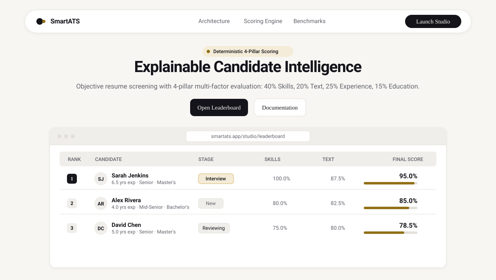
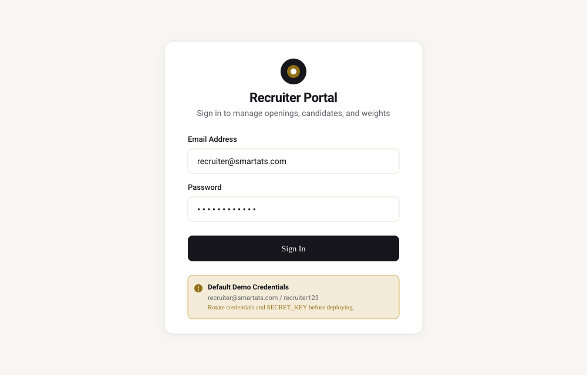
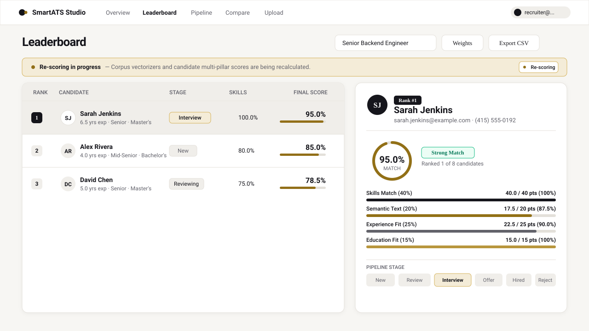

# SmartATS: Explainable Candidate Ranking & Recruitment Intelligence Platform

[](https://github.com/joshimukesh-15/SmartATS/actions/workflows/backend-ci.yml)
[](https://github.com/joshimukesh-15/SmartATS/actions/workflows/frontend-ci.yml)
[](https://www.python.org/downloads/)
[](https://fastapi.tiangolo.com)
[](https://react.dev)
[](https://tailwindcss.com)
[](https://opensource.org/licenses/MIT)

> **Transparent, Objective Recruiter Decision Support**  
> SmartATS replaces unpredictable black-box scoring with an explainable, deterministic multi-pillar ranking engine (Skills, Semantic Text, Experience, Education). Designed for enterprise hiring teams with a high-contrast graphite and champagne visual architecture, tabular typography, and auditable score breakdowns.

Repository: **[https://github.com/joshimukesh-15/SmartATS](https://github.com/joshimukesh-15/SmartATS)**

---

## Table of Contents
1. [Visual Interface & Screenshots](#1-visual-interface--screenshots)
2. [Deterministic 4-Pillar Scoring Engine](#2-deterministic-4-pillar-scoring-engine)
3. [Architecture & Design System](#3-architecture--design-system)
4. [Benchmark & Evaluation Metrics](#4-benchmark--evaluation-metrics)
5. [Getting Started (Local & Docker)](#5-getting-started-local--docker)
6. [Authentication & Credentials](#6-authentication--credentials)
7. [API Reference](#7-api-reference)
8. [Known Limitations](#8-known-limitations)
9. [Automated Testing & CI](#9-automated-testing--ci)

---

## 1. Visual Interface & Screenshots

### Landing Hero & Live Demonstration
Clean, editorial landing view with interactive candidate screening demo, instant weights re-scoring, and proof metrics.



### Recruiter Authentication
JWT-authenticated recruiter sign-in portal with session protection and security advisories.



### Leaderboard & Candidate Dossier
Master-detail recruiter workspace featuring real-time ranking table, interactive stage management, 96px animated score ring, 4-pillar breakdown bars, and background "Re-scoring" indicators.



---

## 2. Deterministic 4-Pillar Scoring Engine

SmartATS does not use opaque generative AI for candidate scoring. Every ranking is calculated deterministically via `GET /api/v1/scoring/config`:

$$\text{Final Score} = (0.40 \times \text{Skills}) + (0.20 \times \text{Semantic Text}) + (0.25 \times \text{Experience}) + (0.15 \times \text{Education})$$

```
Candidate Resume (.pdf / .docx)
       │
       ▼
┌─────────────────────────┐
│ SHA-256 Deduplication   │──(Match)──> Flag as DUPLICATE & Skip
└─────────────────────────┘
       │
       ▼
┌─────────────────────────┐
│ Structured Text Parsing │──(Scanned PDF)──> Tesseract OCR Fallback
└─────────────────────────┘
       │
       ▼
┌─────────────────────────┐
│ Deterministic Extractor │──> Contacts, Standardized Skills Taxonomy,
│ & Experience Normalizer │    Years of Experience, Seniority & Education
└─────────────────────────┘
       │
       ├──────────────┬──────────────┬──────────────┐
       ▼              ▼              ▼              ▼
┌──────────────┐┌──────────────┐┌──────────────┐┌──────────────┐
│Skills Match  ││Semantic Text ││Experience Fit││Education Fit │
│Required + Eq ││Per-Job TF-IDF││Yrs & Level   ││Degree Level  │
│Weight: 40%   ││Weight: 20%   ││Weight: 25%   ││Weight: 15%   │
└──────────────┘└──────────────┘└──────────────┘└──────────────┘
       │              │              │              │
       └──────────────┴───────┬──────┴──────────────┘
                              ▼
       ┌────────────────────────────────────────────────────────┐
       │             Deterministic 4-Pillar Scoring Engine      │
       │ Score = (0.40×Skills) + (0.20×Text) + (0.25×Exp) + (0.15×Edu)│
       └────────────────────────────────────────────────────────┘
                              │
                              ▼
       ┌────────────────────────────────────────────────────────┐
       │ Transparent Point Decomposition & Auditable Explanations│
       │ • Matched Mandatory Skills      • Missing Critical     │
       │ • Functional Equivalencies      • Preferred Skills     │
       └────────────────────────────────────────────────────────┘
```

### Pillar Definitions & Weights

| Pillar | Default Weight | Description | Methodology |
|---|---|---|---|
| **Skills Match** | **40%** (`0.40`) | Mandatory technical skills coverage | Exact token boundary matching against canonical taxonomy, plus functional equivalency detection (e.g. Flask ↔ FastAPI). |
| **Semantic Text Similarity** | **20%** (`0.20`) | Resume-to-job text relevance | Per-job TF-IDF corpus vectorizer with unigrams/bigrams, `sublinear_tf=True`, `smooth_idf=True`, sorted vocabulary, and neutral corpus fallback. |
| **Experience Fit** | **25%** (`0.25`) | Seniority level and domain longevity | Evaluates total years of verified domain experience against job seniority thresholds (Junior, Mid, Senior, Lead). |
| **Education Fit** | **15%** (`0.15`) | Academic qualification level | Standardized degree hierarchy: Doctorate (100%), Master's (90%), Bachelor's (80%), Associate's/Bootcamp (65%). |

Recruiters can adjust pillar weights per job opening via the **Weights Tuner** (`WeightsTunerDialog.jsx`). Weights automatically normalize to 1.0.

### Real-Time Corpus Re-scoring
Whenever a resume is uploaded, deleted, or a job requisition description is updated:
1. The per-job TF-IDF vectorizer cache is invalidated.
2. An asynchronous background task re-evaluates all applications for that job.
3. The Leaderboard and candidate dossiers visibly render the **"Re-scoring"** status with animated pulse indicators until re-computation finishes.

---

## 3. Architecture & Design System

### Design Tokens (Graphite & Champagne)
SmartATS implements an enterprise B2B visual language built on warm paper surfaces, graphite ink, and champagne accents:

| Token | Light Mode | Dark Mode (`.dark`) | Purpose |
|---|---|---|---|
| `--canvas` | `#F7F6F3` | `#0E0E12` | Warm architectural paper ground |
| `--surface` | `#FFFFFF` | `#17171C` | Elevated cards, dialogs, drawers |
| `--surface-alt` | `#F0EEEA` | `#1F1F26` | Tonal tints, table header rows |
| `--line` | `#E3E0DA` | `#2A2A32` | Hairline dividers and borders |
| `--ink` | `#14141A` | `#F4F3F0` | High-contrast primary text (AAA) |
| `--ink-muted` | `#62626B` | `#A1A1AA` | Secondary metadata and labels |
| `--champagne` | `#926F18` | `#D4B15A` | Primary accent, semantic text match |
| `--champagne-soft` | `#F4ECD8` | `#2A2412` | Status badge backgrounds, chip highlights |
| `--danger` | `#B42318` | `#B42318` | Destructive actions, candidate rejection |

### Typography Scale (Geist Sans & Geist Mono)
All numeric scores, percentages, and dates use `tabular-nums` for vertical alignment. A strict **13px accessibility floor** is enforced across all UI components.

| Role | Size | Weight | Tracking | Utility Class |
|---|---|---|---|---|
| **Page Title** | 30px | SemiBold (600) | `-0.03em` | `text-[30px] font-semibold text-ink tracking-[-0.03em]` |
| **Section Title** | 22px | SemiBold (600) | `-0.02em` | `text-[22px] font-semibold text-ink tracking-[-0.02em]` |
| **Card Heading** | 17px | SemiBold (600) | Normal | `text-[17px] font-semibold text-ink` |
| **Body Text** | 15px | Regular (400) | Normal | `text-[15px] leading-[1.6] text-ink` |
| **Secondary / Meta** | 13px | Medium (500) | Normal | `text-[13px] leading-[1.5] text-ink-muted` |
| **Score Figures** | 13px–24px | Bold (700) | Normal | `tabular-nums font-semibold` |

---

## 4. Benchmark & Evaluation Metrics

Benchmarking is performed via `backend/scripts/evaluate.py` across labeled candidate datasets:

### Entity Extraction Metrics (Dataset: 3 jobs, 8 candidates)

| Metric | Before Part 7 (3 jobs, 8 candidates) | After Part 7 (3 jobs, 8 candidates) | Measurement Method |
|---|---|---|---|
| **Email Extraction Accuracy** | **100.0%** (8/8) | **100.0%** (8/8) | RFC-compliant regular expression parsing |
| **Phone Extraction Accuracy** | **100.0%** (8/8) | **100.0%** (8/8) | International and US digit pattern matching |
| **Name Extraction Accuracy** | **87.5%** (7/8) | **87.5%** (7/8) | Header heuristic & entity capitalization |
| **Skill Extraction Precision** | **97.7%** | **97.7%** | Canonical taxonomy token overlap |
| **Skill Extraction Recall** | **100.0%** | **100.0%** | Ground-truth coverage across labeled profiles |
| **Skill Extraction F1-Score** | **98.8%** | **98.8%** | Harmonic mean of precision and recall |
| **Avg Extraction Latency** | **3.50 ms** / resume | **3.28 ms** / resume | Wall-clock execution time per document |

### Ranking Algorithm Performance & Latency: Before vs. After Part 7 (Dataset: 3 jobs, 8 candidates)

Evaluated across all 3 benchmark job requisitions and 8 candidates, showing the impact of the per-job TF-IDF corpus vectorizer with `sublinear_tf=True`, `smooth_idf=True`, sorted vocabulary, and neutral technical corpus stability:

| Algorithm Configuration | Precision@1 (3 jobs, 8 candidates) | Precision@3 (3 jobs, 8 candidates) | Recall@3 (3 jobs, 8 candidates) | NDCG@3 (3 jobs, 8 candidates) | Avg Latency Before Part 7 (3 jobs, 8 candidates) | Avg Latency After Part 7 (3 jobs, 8 candidates) |
|---|---|---|---|---|---|---|
| **Keyword Only (Baseline)** | 1.00 | 1.00 | 0.87 | 1.000 | 3.27 ms | **2.36 ms** |
| **TF-IDF Only (Baseline)** | 1.00 | 0.89 | 0.76 | 0.974 | 2.74 ms | **1.83 ms** |
| **Hybrid (70% KW / 30% Text)** | 1.00 | 1.00 | 0.87 | 1.000 | 2.81 ms | **1.82 ms** |
| **Hybrid (60% KW / 40% Text)** | 1.00 | 1.00 | 0.87 | 1.000 | 2.71 ms | **1.94 ms** |
| **Hybrid (50% KW / 50% Text)** | 1.00 | 1.00 | 0.87 | 1.000 | 2.86 ms | **1.82 ms** |

*Full evaluation outputs are exported to [`backend/reports/evaluation_report.csv`](backend/reports/evaluation_report.csv).*

---

## 5. Getting Started (Local & Docker)

### Prerequisites
- **Python**: 3.11+
- **Node.js**: 20+ (Node 20 or 22 recommended)
- **Tesseract OCR** (optional, for scanned PDF OCR fallback)
- **Docker & Docker Compose** (for containerized deployment)

---

### Option A: Local Development Setup

#### 1. Backend Setup
```bash
# Clone the repository
git clone https://github.com/joshimukesh-15/SmartATS.git
cd SmartATS/backend

# Create and activate Python virtual environment
python -m venv .venv
# Linux / macOS:
source .venv/bin/activate
# Windows:
.venv\Scripts\activate

# Install dependencies
pip install -r requirements.txt

# Run database migrations and seed sample requisitions & candidates
python -m alembic upgrade head
python scripts/seed_demo_data.py

# Start the FastAPI server
uvicorn app.main:app --reload --host 127.0.0.1 --port 8000
```
Interactive OpenAPI documentation will be available at: [http://127.0.0.1:8000/docs](http://127.0.0.1:8000/docs)

#### 2. Frontend Setup
```bash
# Open a new terminal in the frontend directory
cd SmartATS/frontend

# Install dependencies
npm install

# Start Vite development server
npm run dev
```
Open your browser at: [http://localhost:5173](http://localhost:5173)

---

### Option B: Docker Deployment (`docker compose up`)

To build and run the complete multi-stage containerized stack with a single command:

```bash
# From the repository root:
cp .env.docker.example .env
# Edit .env first: set a database password (hex is URL-safe), recruiter password and email,
# a SECRET_KEY generated by `openssl rand -hex 32`, and production ALLOWED_ORIGINS.
# Generate URL-safe passwords with `openssl rand -hex 24`.
docker compose up --build -d
```

The multi-stage Docker build builds the compiled React frontend into FastAPI and serves the entire application and API at [http://localhost:8000](http://localhost:8000).

To view container logs:
```bash
docker compose logs -f
```

To stop containers:
```bash
docker compose down
```

---

## 6. Authentication & Credentials

### Default Demo Credentials
- **Email**: `recruiter@smartats.com`
- **Password**: `recruiter123`

> [!WARNING]
> **Production Security Notice**  
> The default credentials and template `SECRET_KEY` are provided exclusively for local evaluation and automated testing. Before deploying to any staging or production environment:
> 1. Set a unique `DEFAULT_RECRUITER_EMAIL` and a long random `DEFAULT_RECRUITER_PASSWORD` in the environment. This app uses one configured recruiter account; it has no in-app password-change or user-management flow. To rotate the password, update the environment and restart the backend.
> 2. Generate a unique signing key with `openssl rand -hex 32` and set `SECRET_KEY`.
> 3. Set a unique PostgreSQL password and restrict `ALLOWED_ORIGINS` to trusted domains (never use wildcard `*` in production).

---

## 7. API Reference

All recruiter actions require a Bearer token in the `Authorization: Bearer <token>` header.

### Scoring Configuration
- `GET /api/v1/scoring/config`: Returns default 4-pillar weights and mathematical formula description.

### Recruiter Authentication
- `POST /api/v1/auth/login`: Authenticates recruiter credentials and returns JWT access token.
- `GET /api/v1/auth/me`: Returns current authenticated recruiter profile.

### Jobs & Requisitions
- `GET /api/v1/jobs/`: Lists all open job requisitions with application counts.
- `POST /api/v1/jobs/`: Creates a job requisition (with optional custom scoring weights).
- `PUT /api/v1/jobs/{job_id}`: Updates requisition details or persists custom 4-pillar weights.
- `DELETE /api/v1/jobs/{job_id}`: Deletes a job requisition and its associated applications.

### Resume Ingestion & Processing
- `POST /api/v1/jobs/{job_id}/upload-resumes/`: Ingests resume files (`.pdf`, `.docx`), checks SHA-256 binary duplicates, validates magic bytes, and triggers background processing.
- `POST /api/v1/applications/{id}/retry`: Re-queues a failed or interrupted application for processing.
- `GET /api/v1/applications/{id}/download`: Securely downloads applicant resume file.
- `GET /api/v1/applications/{id}/preview`: Streams PDF document for inline browser viewing.

### Candidates & Review Workflow
- `GET /api/v1/jobs/{job_id}/rankings`: Dynamic candidate leaderboard with multi-pillar point breakdowns.
- `POST /api/v1/candidates/compare`: Compares 2 to 5 candidates side-by-side.
- `PUT /api/v1/applications/{id}/stage`: Moves candidate across pipeline stages (`New`, `Reviewing`, `Interviewing`, `Offer`, `Hired`, `Rejected`).
- `POST /api/v1/applications/{id}/notes`: Adds an interview note or evaluation.
- `GET /api/v1/jobs/{job_id}/export/csv`: Exports formula-safe, OWASP-compliant rankings CSV.

---

## 8. Known Limitations

In the interest of engineering transparency, the following technical limitations are noted:

1. **Small Benchmark Dataset**: The current benchmarking suite evaluates 3 job requisitions and 8 labeled candidate resumes. While precision and recall are strong on this set, larger production corpora may exhibit greater variance in skill terminology.
2. **Lexical TF-IDF Text Similarity**: The semantic text similarity pillar uses TF-IDF with n-gram token overlap rather than deep contextual transformer embeddings (such as Sentence-BERT). While fast and deterministic, it relies on lexical overlap rather than latent semantic reasoning.
3. **English-Language Resumes Only**: Entity extraction regexes, phone formatters, and skill dictionaries are tuned for English-language resumes. Multilingual resumes may result in incomplete extraction.
4. **SQLite Local Database Default**: The default configuration runs on SQLite for single-file, zero-dependency local operation. For concurrent multi-user production environments, PostgreSQL should be configured via `DATABASE_URL`.

---

## 9. Automated Testing & CI

### Backend Tests
```bash
cd backend
# Run ruff linter
ruff check .

# Run pytest test suite with coverage
pytest --cov=app --cov-report=term-missing
```

### Frontend Tests & Production Build
```bash
cd frontend
# Run oxlint fast linter
npm run lint

# Run vitest test suite
npm run test

# Compile production bundle
npm run build
```

---

## 10. License

Released under the [MIT License](LICENSE). Built for transparent, explainable recruiter decision support.
